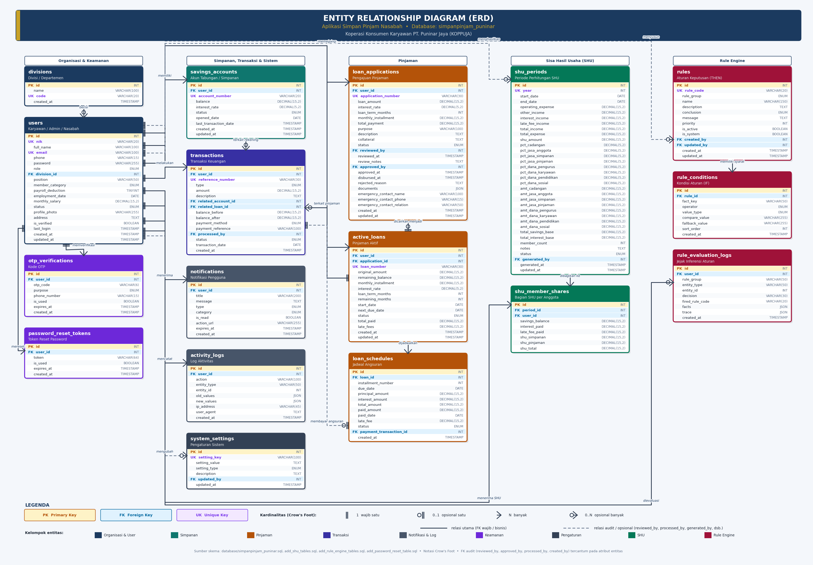

# KOPPUJA — Sistem Simpan Pinjam Karyawan PT. Puninar Jaya

Aplikasi web simpan pinjam untuk **Koperasi Konsumen Karyawan PT. Puninar Jaya (KOPPUJA)**. Aplikasi ini mendigitalkan proses simpanan wajib, pengajuan dan persetujuan pinjaman, pembayaran angsuran, serta perhitungan **Sisa Hasil Usaha (SHU)**. Ketentuan bisnisnya mengikuti keputusan **RAT Tahun Buku 2025**.

Keputusan kelayakan dan persetujuan pinjaman dijalankan oleh **mesin aturan berbasis pengetahuan (rule-based / IF–THEN)**. Aturan disimpan di database, sehingga pengurus dapat menambah, mengubah, atau menonaktifkannya tanpa mengubah kode program.


---

## Daftar Isi

1. [Latar Belakang](#latar-belakang)
2. [Fitur](#fitur)
3. [Ketentuan Bisnis (RAT 2025)](#ketentuan-bisnis-rat-2025)
4. [Mesin Aturan (Rule Engine)](#mesin-aturan-rule-engine)
5. [Perhitungan SHU](#perhitungan-shu)
6. [Arsitektur & Teknologi](#arsitektur--teknologi)
7. [Struktur Database (ERD)](#struktur-database-erd)
8. [Struktur Direktori](#struktur-direktori)
9. [Instalasi](#instalasi)
10. [Akun Demo](#akun-demo)
11. [Pengujian (Boundary Value Analysis)](#pengujian-boundary-value-analysis)
12. [Keamanan](#keamanan)
13. [Catatan Pengembangan Lanjutan](#catatan-pengembangan-lanjutan)

---

## Latar Belakang

Sebelumnya, pengelolaan simpan pinjam koperasi karyawan dilakukan secara manual: formulir kertas, rekap spreadsheet, dan pengecekan syarat oleh pengurus. Akibatnya:

- Pengecekan syarat pinjaman (masa kerja, plafon, tenor) lambat dan rawan tidak konsisten.
- Anggota sulit memantau saldo simpanan, sisa pinjaman, dan jadwal angsuran.
- Perhitungan dan pembagian SHU di akhir tahun memakan waktu.

Aplikasi ini memusatkan semua proses tersebut dalam satu sistem dengan dua peran utama: **Nasabah (anggota/karyawan)** dan **Admin (pengurus/HRD/Finance)**.

---

## Fitur

### Nasabah (Anggota)

| Fitur | Keterangan |
|---|---|
| Dashboard | Ringkasan saldo simpanan wajib, pinjaman aktif, angsuran berikutnya, notifikasi, dan estimasi SHU tahun berjalan |
| Simpanan Wajib | Melihat saldo, setor simpanan wajib, dan mencetak rekening koran (statement). Simpanan bersifat **beku** selama masih menjadi anggota |
| Pengajuan Pinjaman | Formulir dengan **kalkulator angsuran otomatis** (bunga flat). Plafon dan tenor maksimal tampil sesuai kategori anggota |
| Persetujuan Otomatis | Pengajuan yang memenuhi kriteria langsung disetujui sistem; lainnya diteruskan ke review pengurus |
| Pembayaran Angsuran | Jadwal angsuran per bulan, penanda keterlambatan, dan perhitungan denda |
| Riwayat Transaksi | Filter berdasarkan jenis dan tanggal |
| SHU Saya | Rincian SHU jasa simpanan dan jasa pinjaman milik anggota |
| Notifikasi | Status pengajuan, pengingat pembayaran, aktivitas akun |
| Profil & Keamanan | Ubah password, lupa password via token email |

### Admin (Pengurus)

| Fitur | Keterangan |
|---|---|
| Dashboard Statistik | Pengajuan pending, pinjaman aktif, total outstanding, total simpanan, grafik transaksi 12 bulan, peminjam terbesar |
| Manajemen Anggota | Registrasi nasabah (otomatis membuka rekening simpanan), aktif/nonaktifkan akun, atur **kategori anggota** dan **status potongan HRD** |
| Persetujuan Pinjaman | Daftar pengajuan dengan filter dan pencarian, detail pengajuan, setujui/tolak beserta catatan |
| Pinjaman Aktif & Tunggakan | Monitoring sisa pinjaman, daftar angsuran terlambat, kirim pengingat pembayaran |
| Simpanan & Transaksi | Daftar rekening simpanan dan seluruh transaksi |
| Basis Aturan | CRUD aturan IF–THEN, aktif/nonaktifkan aturan, **simulasi** keputusan, dan log jejak penalaran |
| Laporan SHU | Hitung SHU per tahun buku, alokasi dana, pembagian per anggota, simpan draf, kunci final, export CSV, dan cetak |
| Laporan | Rekap keuangan per periode |
| Pengaturan | Bunga, tenor, kelipatan plafon, minimal simpanan, denda, batas auto-approve, dan persentase alokasi SHU |

---

## Ketentuan Bisnis (RAT 2025)

| Ketentuan | Nilai bawaan | Dapat diubah |
|---|---|---|
| Plafon pinjaman — karyawan/driver dengan **potongan HRD/Yayasan** | **2× simpanan wajib** | ✅ |
| Plafon pinjaman — **outsourcing / angsur mandiri** | **1× simpanan wajib** | ✅ |
| Tenor standar | maks. **12 bulan** | ✅ |
| Tenor kebijakan khusus (dengan surat pernyataan bermaterai) | maks. **18 bulan** | ✅ |
| Minimal simpanan wajib | **Rp 50.000** | ✅ |
| Minimal masa kerja | **12 bulan** | ✅ |
| Bunga pinjaman | **1,5% per bulan (flat)** | ✅ |
| Denda keterlambatan | **0,5% per hari** dari nilai angsuran | ✅ |
| Simpanan sukarela | **Ditiadakan** (RAT ke-19) | — |
| Penarikan simpanan wajib | Hanya saat keluar keanggotaan (oleh pengurus) | — |
| Batas auto-approve | ≤ Rp 5.000.000 dan tenor ≤ 12 bulan | ✅ |

**Rumus angsuran (bunga flat):**

```
Angsuran per bulan = (Pokok ÷ Tenor) + (Pokok × Bunga per bulan)
Total pembayaran   = Angsuran per bulan × Tenor
```

Contoh: pinjaman Rp 3.000.000, tenor 12 bulan, bunga 1,5% menghasilkan angsuran Rp 250.000 + Rp 45.000 = **Rp 295.000/bulan**.

---

## Mesin Aturan (Rule Engine)

Logika keputusan pinjaman ada di `classes/RuleEngine.php` dan memakai pendekatan **sistem pakar berbasis aturan (forward chaining sederhana)**:

1. Sistem mengumpulkan **fakta** tentang nasabah dan pengajuan, misalnya `masa_kerja_bulan`, `simpanan_wajib`, `plafon_maksimal`, `jumlah_pinjaman`, `tenor_bulan`, `potongan_hrd`, dan `riwayat_tunggakan`.
2. Setiap **aturan** terdiri dari satu atau lebih **kondisi IF** (digabung dengan AND) dan satu **kesimpulan THEN** (`reject`, `manual_review`, atau `approve`).
3. Aturan dievaluasi berurutan berdasarkan **prioritas**. Aturan pertama yang terpenuhi menentukan kesimpulan.
4. Nilai pembanding bisa berupa angka tetap, **pengaturan sistem**, atau **fakta lain**.
5. Setiap evaluasi disimpan ke `rule_evaluation_logs` sebagai jejak penalaran (audit trail).

### Kelompok 1 — Kelayakan Pengajuan (`loan_eligibility`)

| Kode | JIKA | MAKA |
|---|---|---|
| R01 | masa kerja < minimal masa kerja | Tolak |
| R02 | masih punya pinjaman aktif | Tolak |
| R03 | masih ada pengajuan yang diproses | Tolak |
| R04 | status kepegawaian ≠ aktif | Tolak |
| R08 | simpanan wajib < minimal simpanan | Tolak |
| R05 | jumlah pinjaman > plafon (1×/2× simpanan wajib) | Tolak |
| R06 | tenor > tenor maksimal kebijakan (18 bulan) | Tolak |
| R07 | rasio angsuran terhadap gaji > 40% *(nonaktif bawaan)* | Tolak |

### Kelompok 2 — Keputusan Persetujuan (`loan_decision`)

| Kode | JIKA | MAKA |
|---|---|---|
| R10 | fitur auto-approve nonaktif | Review manual |
| R11 | jumlah pinjaman > batas auto-approve | Review manual |
| R16 | anggota outsourcing / tanpa potongan HRD | Review manual |
| R15 | tenor > tenor standar (12 bulan) | Review manual |
| R12 | tenor > batas tenor auto-approve | Review manual |
| R13 | riwayat tunggakan ≥ 3 kali | Review manual |
| R14 | *(aturan penutup)* tidak ada aturan review yang terpenuhi | **Setujui otomatis** |

Jika tabel aturan belum dimigrasikan, sistem otomatis memakai aturan bawaan di kode (*legacy fallback*), sehingga aplikasi tetap berjalan.

---

## Perhitungan SHU

Diimplementasikan di `classes/SHUManager.php`.

```
Pendapatan = Bunga pinjaman terbayar + Denda terbayar + Pendapatan lain
Beban      = Biaya operasional
SHU        = Pendapatan − Beban
```

**Alokasi SHU (bawaan, dapat diubah, total wajib 100%):**

| Pos | % |
|---|---|
| Cadangan koperasi | 25% |
| Jasa anggota | 40% |
| Dana pengurus | 10% |
| Dana karyawan | 5% |
| Dana pendidikan | 10% |
| Dana sosial | 10% |

**Jasa anggota** dibagi 50% jasa simpanan dan 50% jasa pinjaman:

```
SHU jasa simpanan anggota = (simpanan wajib anggota ÷ total simpanan) × pool jasa simpanan
SHU jasa pinjaman anggota = (bunga dibayar anggota ÷ total bunga)   × pool jasa pinjaman
```

Selisih pembulatan dialokasikan ke anggota terakhir agar total pembagian sama persis dengan pool. Laporan dapat disimpan sebagai **draf**, dikunci sebagai **final**, di-export ke **CSV**, dan dicetak.

---

## Arsitektur & Teknologi

| Lapisan | Teknologi |
|---|---|
| Backend | PHP 8 (native, berorientasi objek), PDO dengan prepared statements |
| Database | MySQL / MariaDB (InnoDB, foreign key, view, index) |
| Frontend | HTML5, Bootstrap 5.3, Font Awesome 6, JavaScript (ES6), Chart.js |
| Server lokal | XAMPP (Apache + MariaDB) |
| Dokumentasi | Skrip Python untuk generate ERD dan dokumen pengujian (`docs/`) |

**Kelas inti (`classes/`):**

| Kelas | Tanggung jawab |
|---|---|
| `Database` / `DatabaseHelper` | Koneksi singleton PDO, helper query, pengaturan sistem, nomor referensi, log aktivitas, notifikasi |
| `Auth` / `SecurityHelper` | Login, sesi & timeout, CSRF, role, registrasi nasabah, reset password, sanitasi & validasi input |
| `RuleEngine` | Evaluasi aturan IF–THEN, CRUD aturan, log penalaran |
| `LoanManager` | Fakta pinjaman, kelayakan, pengajuan, auto-approve, review admin, jadwal angsuran, pembayaran |
| `SavingsManager` | Rekening simpanan wajib, setoran, statement, statistik |
| `SHUManager` | Perhitungan, alokasi, pembagian, dan penyimpanan laporan SHU |
| `EmailHelper` | Template dan pengiriman email (reset password, notifikasi) |

---

## Struktur Database (ERD)



Tabel utama: `users`, `divisions`, `savings_accounts`, `loan_applications`, `active_loans`, `loan_schedules`, `transactions`, `notifications`, `system_settings`, `activity_logs`, `password_reset_tokens`, `otp_verifications`, `rules`, `rule_conditions`, `rule_evaluation_logs`, `shu_periods`, `shu_member_shares`.

View: `view_nasabah_dashboard`, `view_admin_dashboard`, `view_financial_report`.

---

## Struktur Direktori

```
├── admin/                     # Halaman persetujuan (pinjaman & penarikan)
├── ajax/                      # Endpoint AJAX (notifikasi, pengingat pembayaran)
├── assets/css/                # Stylesheet nasabah & admin
├── classes/                   # Kelas inti (Database, Auth, RuleEngine, LoanManager, ...)
├── config/config.php          # Konfigurasi DB, aplikasi, & ketentuan bisnis
├── database/                  # Skema SQL & migrasi
│   ├── simpanpinjam_puninar.sql
│   ├── add_password_reset_table.sql
│   ├── add_rule_engine_tables.sql
│   ├── add_shu_tables.sql
│   └── update_koppuja_rat2025_rules.sql
├── docs/                      # ERD, dokumen pengujian BVA, rangkuman SHU
├── includes/                  # Bootstrap aplikasi, helper, layout admin
├── tests/run_bva_tc15_26.php  # Pengujian otomatis Boundary Value Analysis
├── admin-*.php                # Halaman panel admin
├── dashboard.php, loans.php, savings.php, apply-loan.php, loan-payment.php, shu.php, ...
└── login.php, forgot-password.php, reset-password.php
```

---

## Instalasi

### Prasyarat
- XAMPP (PHP ≥ 8.0, MySQL/MariaDB) atau Apache/Nginx + PHP + MySQL
- Ekstensi PHP: `pdo_mysql`, `openssl`, `mbstring`, `json`

### Langkah

1. **Clone repositori** ke folder web server:
   ```bash
   cd C:/xampp/htdocs
   git clone https://github.com/whympxx/Koperasi-Simpan-Pinjam.git
   ```

2. **Buat database** dan jalankan skrip SQL secara berurutan (via phpMyAdmin atau CLI):
   ```bash
   mysql -u root -p < database/simpanpinjam_puninar.sql
   mysql -u root -p < database/add_password_reset_table.sql
   mysql -u root -p < database/add_rule_engine_tables.sql
   mysql -u root -p < database/add_shu_tables.sql
   mysql -u root -p < database/update_koppuja_rat2025_rules.sql
   ```

3. **Sesuaikan konfigurasi** di `config/config.php`:
   ```php
   define('DB_HOST', 'localhost');
   define('DB_NAME', 'simpanpinjam_puninar');
   define('DB_USER', 'root');
   define('DB_PASS', '');
   define('APP_URL', 'http://localhost/<nama-folder>/');
   define('SECRET_KEY', 'ganti-dengan-kunci-acak-anda');
   ```

4. **Pastikan folder `logs/` dan `uploads/` dapat ditulis** oleh web server.

5. Buka `http://localhost/<nama-folder>/` di browser.

---

## Akun Demo

Semua akun contoh menggunakan password **`password`**.

| Peran | NIK |
|---|---|
| Super Admin | `ADMIN001` |
| Admin (HRD) | `HRD001` |
| Admin (Finance) | `FIN001` |
| Nasabah | `PUN001`, `PUN002`, `PUN003` |

> ⚠️ Ganti password akun demo dan `SECRET_KEY` sebelum dipakai di lingkungan produksi.

---

## Pengujian (Boundary Value Analysis)

Pengujian nilai batas pada mesin aturan dan validasi formulir dijalankan otomatis:

```bash
php tests/run_bva_tc15_26.php
```

Hasil terakhir: **12 dari 12 kasus uji lulus** (`docs/bva_tc15_26_results.json`).

| ID | Skenario nilai batas | Hasil |
|---|---|---|
| TC-15 | Masa kerja 12 vs 11 bulan (R01) | ✅ Lulus |
| TC-16 | Simpanan wajib Rp 50.000 vs Rp 49.999 (R08) | ✅ Lulus |
| TC-17 | Plafon 2× simpanan: Rp 4.000.000 vs Rp 4.000.001 (R05) | ✅ Lulus |
| TC-18 | Plafon 1× simpanan: Rp 2.000.000 vs Rp 2.000.001 (R05) | ✅ Lulus |
| TC-19 | Tenor maksimum kebijakan 18 vs 19 bulan (R06) | ✅ Lulus |
| TC-20 | Rasio angsuran terhadap gaji 40% vs 41% (R07, nonaktif) | ✅ Lulus |
| TC-21 | Nominal auto-approve Rp 5.000.000 vs Rp 5.000.001 (R11) | ✅ Lulus |
| TC-22 | Tenor auto-approve 12 vs 13 bulan (R12/R15) | ✅ Lulus |
| TC-23 | Riwayat tunggakan 2 vs 3 kali (R13) | ✅ Lulus |
| TC-24 | Nominal minimum formulir Rp 100.000 vs Rp 99.999 | ✅ Lulus |
| TC-25 | Domain tenor formulir 1 & 18 vs 0 & 19 bulan | ✅ Lulus |
| TC-26 | Sakelar auto-approve (R10) dan potongan HRD (R16): 1 vs 0 | ✅ Lulus |

Dokumen lengkap tersedia di [`docs/Pengujian_Nilai_Batas_BVA.pdf`](docs/Pengujian_Nilai_Batas_BVA.pdf), dan rangkuman fitur SHU di [`docs/Rangkuman_Penambahan_Perhitungan_SHU.pdf`](docs/Rangkuman_Penambahan_Perhitungan_SHU.pdf).

---

## Keamanan

- Password di-hash dengan **bcrypt** (`password_hash`)
- **CSRF token** pada form transaksi dan admin
- **Prepared statements** (PDO, emulasi nonaktif) untuk mencegah SQL injection
- Sanitasi output (`htmlspecialchars`) untuk mencegah XSS
- **Session timeout** 15 menit, `session_regenerate_id` saat login, cookie `HttpOnly` & `SameSite=Strict`
- Kontrol akses berbasis peran (nasabah / admin / super_admin)
- Token reset password acak 64 karakter, berlaku 1 jam, sekali pakai
- **Audit trail**: log aktivitas pengguna dan log jejak penalaran rule engine

---

## Catatan Pengembangan Lanjutan

Hasil *crosscheck* fungsional menemukan beberapa hal yang sedang/akan diperbaiki:

- Perbaikan alur pembayaran angsuran: perhitungan sisa tenor, denda yang terhitung ganda, validasi nominal dan kepemilikan jadwal.
- Pencegahan persetujuan ganda pada pengajuan yang sudah diproses.
- Verifikasi setoran simpanan oleh admin sebelum saldo bertambah.
- Penandaan otomatis status angsuran `overdue` dan pembaruan `next_due_date`.
- Melengkapi kolom database yang direferensikan fitur notifikasi, pengingat pembayaran, dan *remember me*.
- Menampilkan snapshot SHU yang sudah difinalkan (bukan dihitung ulang).

---

## Pengembang

Dikembangkan oleh **[@whympxx](https://github.com/whympxx)** sebagai aplikasi Sistem Simpan Pinjam untuk Koperasi Konsumen Karyawan PT. Puninar Jaya (KOPPUJA).
